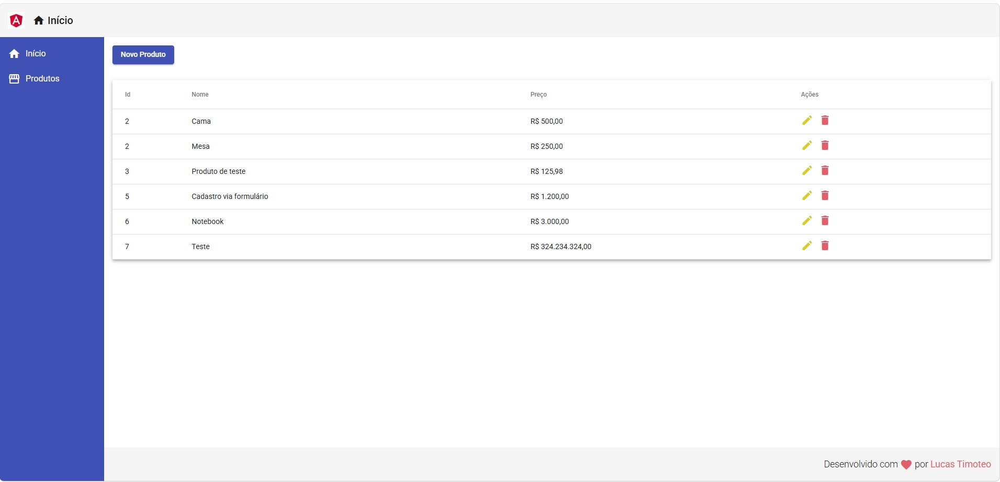
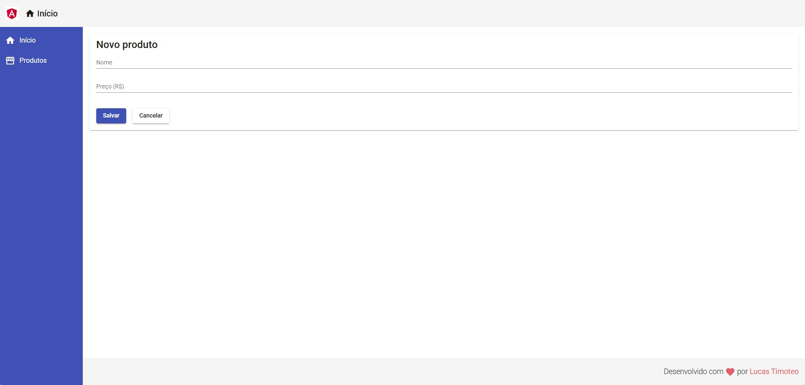

# CRUD de Produtos com Angular

Este projeto é uma aplicação simples para cadastro e gerenciamento de produtos, desenvolvida como meu primeiro projeto com Angular para fins didáticos. A ideia é praticar a construção de uma interface com Angular e Angular Material e a comunicação com uma API REST simulada pelo `json-server`.

## Funcionalidades

- Listar produtos com identificador, nome e preço em reais.
- Cadastrar novos produtos.
- Editar produtos existentes.
- Excluir produtos.
- Exibir mensagens de confirmação após as operações.

## Telas

### Lista de produtos

A tabela apresenta os produtos cadastrados e oferece ações para editar ou excluir cada item.



### Cadastro de produto

O formulário permite informar o nome e o preço do produto.



## Tecnologias

- Angular 9
- Angular Material
- TypeScript e RxJS
- `json-server` como API REST local

## Como executar

É necessário ter Node.js e npm instalados. O frontend e o backend devem ser iniciados em terminais separados.

### 1. Inicie a API

Na raiz do repositório:

```bash
cd backend
npm install
npm start
```

A API ficará disponível em `http://localhost:3001`, e os produtos serão servidos em `http://localhost:3001/products`. Os dados de exemplo estão em `backend/db.json`.

### 2. Inicie o frontend

Em outro terminal, na raiz do repositório:

```bash
cd frontent
npm install
npm start
```

Abra `http://localhost:4200` no navegador. Mantenha a API em execução para que as operações com produtos funcionem.

## Organização do projeto

```text
.
├── assets/       # Capturas de tela usadas neste README
├── backend/      # API local e dados de exemplo
└── frontent/     # Aplicação Angular
    └── src/app/
        ├── components/product/  # Cadastro, listagem, edição e exclusão
        ├── components/template/ # Cabeçalho, navegação e rodapé
        └── views/               # Páginas da aplicação
```

## Rotas principais

- `/` — página inicial
- `/products` — listagem de produtos
- `/products/create` — cadastro de produto
- `/products/update/:id` — edição de produto
- `/products/delete/:id` — confirmação de exclusão

Este repositório tem finalidade educacional. O `json-server` e o arquivo JSON são usados para simular uma API e persistência local durante o desenvolvimento.